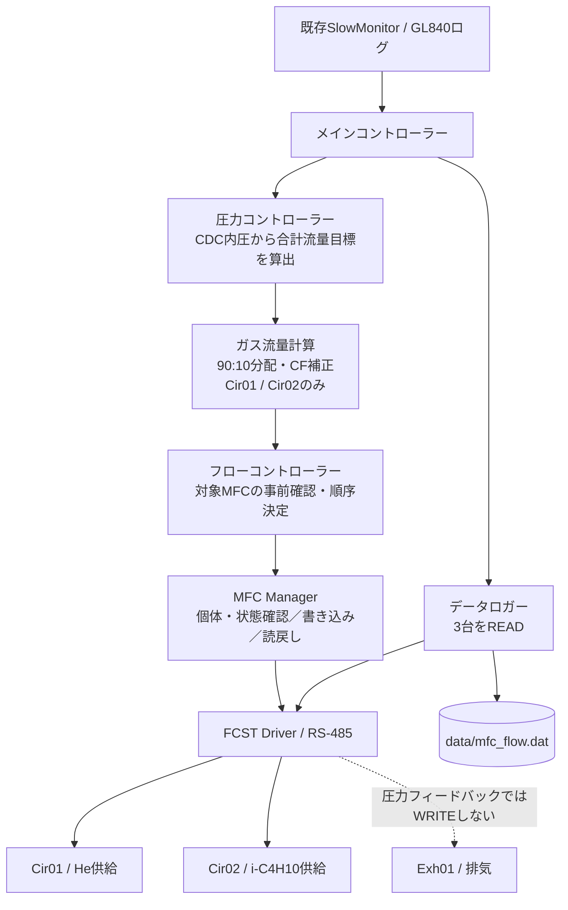
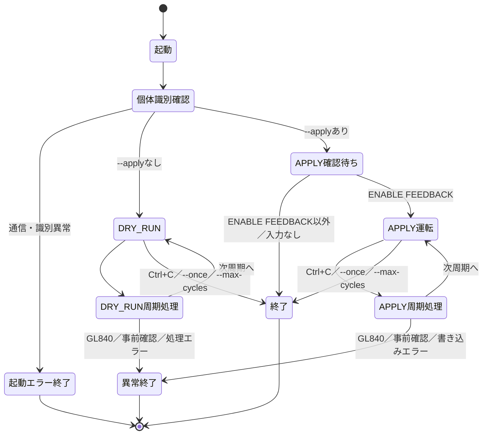

# COMET CDC Gas Replacement Control System

## 1. 概要と制御対象

本ソフトウェアは、COMET Phase-I実験のCentral Drift Chamber（CDC）で使用するHe:i-C4H10（イソブタン）= 90:10の混合ガスについて、ガス置換・循環時の供給流量を管理し、CDC内圧に応じた供給流量のフィードバック調整を行うPythonプログラムである。

FUJIKIN FCSTシリーズのMFC 3台をRS-485で管理する。ただし、**圧力フィードバックによって設定値を変更するMFCは供給側のCir01とCir02のみ**である。排気側のExh01は、起動時の個体識別・状態確認および周期ログの対象として管理するが、圧力フィードバックの設定値計算・事前確認・書き込み対象には含めない。フィードバック運転中、Exh01の既存設定値は変更しない。

一方、`control/flow_controller.py`および`gas/gas_replacement.py`は、既定では従来どおり3台を含む計画を生成する。単独のフローコントローラーから明示的に全停止を指示する場合は、Cir01、Cir02、Exh01の3台すべてを停止対象とする。したがって、次の2つを区別する。

| 処理 | Cir01 | Cir02 | Exh01 |
|---|---|---|---|
| メインコントローラーの圧力フィードバック | 流量変更対象 | 流量変更対象 | 設定値を変更しない |
| 3台を対象とする単独フロー操作 | 操作対象 | 操作対象 | 操作対象 |
| 3台を対象とする明示的な停止操作（現在が正流量） | 0 sccmを設定 | 0 sccmを設定 | 0 sccmを設定 |
| 起動時の個体識別・状態読み出し | 対象 | 対象 | 対象 |
| 周期流量ログ | 対象 | 対象 | 対象 |

CDC内圧は、既存のSlowMonitorシステムが出力するGL840ログファイルから取得する。本ソフトウェアはGL840と直接通信せず、ログファイルの最新データを読み取る。

メインコントローラーの標準動作はDRY RUNであり、MFCへの流量設定書き込みは行わない。実機への自動書き込みには起動オプション`--apply`と、オペレーターが`ENABLE FEEDBACK`と入力する明示的な確認が必要である。

> **重要:** 本ソフトウェアは、ガス系全体の安全を保証する独立した安全計装システムではない。GL840データの異常や制御プログラムの例外でプロセスが終了しても、MFCへ自動的に0 sccmを書き込む機能はない。最後に設定されたMFC状態が維持される可能性があるため、異常時の現場対応手順、緊急排気、ガス遮断などはハードウェア側の手順として別途定めること。

## 2. ハードウェア構成

### 2.1 MFC一覧

| MFC名 | 用途 | シリアル番号 | MAC ID | フルスケール | 最小正流量設定 |
|---|---|---|---:|---:|---:|
| Cir01 | He供給 | `AT18ZQW-00` | `0x21` | 5000 sccm（5 SLM） | 100 sccm（2% F.S.） |
| Cir02 | i-C4H10供給 | `AT1MSM9-00` | `0x22` | 400 sccm | 8 sccm（2% F.S.） |
| Exh01 | CDC排気（90:10混合ガス） | `AT1MSM6-00` | `0x24` | 1000 sccm（1 SLM） | 20 sccm（2% F.S.、暫定値） |

3台とも校正ガスはHe:i-C4H10 = 90:10の混合ガスである。Cir01には純He、Cir02には純i-C4H10、Exh01には混合ガスが流れる。

### 2.2 ガス組成と流量補正係数

目標混合比は以下のとおりである。

- He：90%
- i-C4H10：10%

FUJIKINから提示された流量補正係数（CF）は以下を使用する。

| ガス | CF |
|---|---:|
| He | 1.428 |
| i-C4H10 | 0.210 |
| He:i-C4H10 = 90:10混合ガス | 0.946 |

MFCは混合ガスで校正されている一方、供給側のCir01とCir02には純ガスが流れる。そのため、`gas/gas_replacement.py`では校正ガスと実際に流すガスのCF比を用いてMFC設定値を計算する。

合計混合ガス流量を\(Q_{mix}\)とすると、実ガス流量の目標は次のとおりである。

\[
Q_{He}=0.90Q_{mix},\qquad Q_{iC_4H_{10}}=0.10Q_{mix}
\]

MFC設定値は、次式で計算する。

\[
Q_{set}=Q_{actual}\times\frac{CF_{calibration}}{CF_{flowing}}
\]

例えば、合計混合ガス流量が200 sccmの場合は次のようになる。

| MFC | 実ガス流量の目標 | MFC設定値（CF補正後） |
|---|---:|---:|
| Cir01 | He 180 sccm | 約119.244 sccm |
| Cir02 | i-C4H10 20 sccm | 約90.095 sccm |
| Exh01 | 混合ガス 200 sccm | 200.000 sccm |

圧力フィードバックではCir01とCir02の設定値のみを計算する。Exh01の設定値はこの計算結果から生成しない。

### 2.3 正流量の動作範囲

現在のCFおよびMFCプロファイルに基づく合計混合ガス流量の正流量範囲は、約167.72～887.95 sccmである。現在の設定では、下限はCir01の最小正流量、上限はCir02のフルスケールによって決まる。Exh01の設定範囲は現時点の上下限を狭めていない。

- 0 sccm：正流量範囲とは別の停止指令値。
- 約167.72～887.95 sccm：現在の設定で許容される正流量範囲。
- 0より大きく約167.72 sccm未満：Cir01の最小正流量条件を満たさないため使用不可。
- 約887.95 sccm超：Cir02のフルスケール条件を満たさないため使用不可。

なお、`control/pressure_controller.py`の流量範囲計算には現状3台分の上限・下限が含まれるが、現行プロファイルでは上記のとおり供給MFCの制限が範囲を決めており、Exh01の値は結果に影響していない。Exh01のプロファイル値を変更する場合は、圧力コントローラー側の範囲計算との整合性を再確認すること。

Exh01の最小流量20 sccmは、`config/mfc_profiles.py`で実機確認前の暫定値として定義している。実機仕様および評価結果に基づき確認する必要がある。

## 3. ディレクトリ構成

```text
fcst_gas_replacement/
│
├── README.md
├── fcst_gas_replacement_controller.py
│
├── config/
│   └── mfc_profiles.py
│
├── mfc/
│   ├── fcst_driver.py
│   └── mfc_manager.py
│
├── gas/
│   └── gas_replacement.py
│
├── control/
│   ├── flow_controller.py
│   └── pressure_controller.py
│
├── logging/
│   └── data_logger.py
│
└── data/
    └── mfc_flow.dat  （実行時に自動生成）
```

`logging/data_logger.py`はMFC流量を記録するプログラム本体である。`data/mfc_flow.dat`は実行時に生成される記録ファイルであり、プログラム本体とは別である。メインコントローラーは`data/data_logger.py`または`logging/data_logger.py`を読み込む。両方に同名ファイルを配置した場合は`data/`側が優先される。

| ディレクトリ | 役割 |
|---|---|
| `config/` | MFCごとの個体情報・流量仕様の定義 |
| `mfc/` | FCST MFCとの通信および状態・設定の管理 |
| `gas/` | 混合比とCFに基づくMFC設定流量の計算 |
| `control/` | 圧力フィードバック判断と複数MFCの協調制御 |
| `logging/` | MFC流量データの記録処理 |
| `data/` | 実行時に生成される測定データの保存先 |

## 4. 制御プログラムの全体設計

### 4.1 制御の役割分担

制御処理は、圧力に応じた合計流量の決定、供給MFC設定値の計算、MFCの事前確認、MFCへの書き込みに分離している。

1. `pressure_controller.py`：GL840ログからCDC内圧を取得し、次の合計流量目標を計算する。MFCへの通信・書き込みは行わない。
2. `gas_replacement.py`：合計流量目標をHe 90%、i-C4H10 10%に分配し、CF補正後のMFC設定値を計算する。`include_exhaust=False`の場合はCir01・Cir02のみを計算する。
3. `flow_controller.py`：計算結果に含まれるMFCのみを事前確認し、流量の増減に応じた書き込み順序を決定する。
4. `mfc_manager.py`：個体識別、設定範囲、Control Mode、Freeze Followを確認し、許可された場合に設定値を書き込んで読み戻し検証する。
5. `fcst_driver.py`：RS-485通信フレームの送受信、応答、ACK/NAK、タイムアウトなどを扱う。
6. `data_logger.py`：3台のSetpointとIndicated Flowを読み取り専用で記録する。

メインコントローラーでは、圧力フィードバックに`include_exhaust=False`を明示している。これにより、フィードバック経路のガス計画、事前確認、書き込み順序にはCir01・Cir02だけが含まれる。Exh01は起動時と周期ログでは読み取るが、圧力フィードバックから書き込まれない。

### 4.2 ソフトウェア構成図



図中のExh01への点線は、排気MFCがRS-485上の管理対象でありログ対象でもあることを示す。圧力フィードバックの設定値書き込み経路には含まれない。

### 4.3 起動から通常運転まで

メインコントローラーの起動時は、以下の順序で処理する。

1. RS-485ポートを開く。
2. `read_all_status()`でCir01、Cir02、Exh01のシリアル番号、MAC ID、制御モード、Freeze Follow、Setpointなどを読み出し、登録情報との一致を確認する。
3. `--current-flow-sccm`で指定した現在の指令合計流量からCir01・Cir02の期待Setpointを計算する。
4. Cir01・Cir02がDigitalモードの場合は、実際のSetpointレジスタと期待値を比較する。Exh01は個体識別と状態を読み出すが、供給流量を基準にしたSetpoint照合は行わない。
5. Cir01またはCir02がAnalogモードの場合、Digital Setpointレジスタではアナログ入力指令値を検証できないため警告を表示し、そのMFCの照合をスキップする。
6. DRY RUNなら読み取り・計算・事前確認だけを行う。`--apply`を指定した場合は、オペレーターが`ENABLE FEEDBACK`と入力した後に自動書き込みを許可する。
7. ログ取得と圧力フィードバックを同じRS-485接続で順番に実行する。

起動時の個体識別確認は3台すべてを対象とする。いずれかのMFCで通信・個体識別に失敗した場合は、コントローラーを起動できない。一方、現在流量とのSetpoint整合確認はCir01・Cir02のみを対象とする。

### 4.4 通常運転の周期

| 処理 | デフォルト周期 | 内容 |
|---|---:|---|
| MFCログ | 1秒 | 3台のSetpoint・Indicated Flowを読み出して記録 |
| 圧力フィードバック | 5秒 | GL840ログを読み、Cir01・Cir02の次の設定値を計算・事前確認し、必要に応じて書き込む |

ログ取得とフィードバックは、同じRS-485接続を逐次使用する。並列通信は行わない。1秒ログ周期はベストエフォートであり、MFC通信やフィードバック処理が長引けば周期は遅れる。処理が遅れた場合に過去分を連続して取り戻す動作は行わない。

### 4.5 圧力フィードバックの判断

デフォルトの目標CDC内圧は100 Paである。最新のCDC内圧に応じ、現在の指令合計流量に対して次の割合で変更する。

| CDC内圧 | 合計流量目標の変更 | 制御判断 |
|---|---:|---|
| 120 Pa超 | −10% | 大きく減少 |
| 100 Pa超～120 Pa以下 | −2% | 小さく減少 |
| 50 Pa以上～100 Pa以下 | 変更なし | 維持 |
| 20 Pa以上～50 Pa未満 | +5% | 増加 |
| 0 Pa以上～20 Pa未満 | +10% | 大きく増加 |
| 0 Pa未満 | +20% | より大きく増加 |

判定境界はコードの不等号に従う。例えば、120 Paちょうどでは−2%、100 Paちょうどでは維持、50 Paちょうどでは維持、20 Paちょうどでは+5%、0 Paちょうどでは+10%となる。

変更後の正流量目標は、現在の設定範囲である約167.72～887.95 sccmに制限する。計算値が下限未満になった場合は下限値を維持し、フィードバック判断だけで自動停止指令を出さない。上限を超えた場合も上限値に制限する。

現在流量が0 sccmの場合は`HOLD_STOPPED`となり、圧力にかかわらず自動再起動しない。バッファータンク圧力もGL840ログから読み取って表示するが、現行のフィードバック判断に使用するのはCDC内圧である。

### 4.6 フィードバック時のMFC設定値更新

圧力フィードバックの1サイクルでは、以下を行う。

1. CDC内圧から合計流量目標を計算する。
2. `calculate_gas_replacement_plan(..., include_exhaust=False)`を呼び出し、Cir01・Cir02の設定値だけを計算する。
3. `FlowController`にも`include_exhaust=False`を渡す。
4. Cir01・Cir02それぞれについて、個体情報、設定可能範囲、現在の制御状態、設定値計画を事前確認する。
5. どちらかの事前確認に失敗した場合は、1台も書き込まずエラーにする。
6. 流量変更が必要な場合、Cir01、Cir02の順に書き込む。
7. 書き込み後のSetpoint等を読み戻し、要求値が反映されたことを確認する。

**Exh01はこのフィードバック計画に含まれない。** したがって、Exh01に対するフィードバック由来のSetpoint WRITE、事前確認、流量増減順序への参加はない。起動時の個体識別・状態確認と、ログのREADは継続する。

## 5. MFCの設定・書き込み方針

### 5.1 MFCの流量値とレジスタ換算

アプリケーション内の流量単位はsccmに統一する。FCSTのSetpoint・Indicated Flowレジスタは16 bitで、`0x4000`を0%、`0xC000`を100% F.S.として線形換算する。正流量の量子化は要求値を下回らないように切り上げる。0 sccmは専用停止値`0x4000`となる。

SetpointやIndicated Flowを`sccm`へ換算する際は各MFCのフルスケール値を使用する。データロガーの記録値はMFC内部のレジスタ値を線形換算したものであり、ガス固有のCF補正は行わない。

### 5.2 Control ModeとFreeze Follow

`MFCManager.set_flow_sccm()`による書き込みでは、次の確認・処理を行う。

- 書き込み前に個体識別を再確認する。
- 現在のControl Mode、Default Control Mode、Freeze Followを読み直す。
- Analogモードの場合はDigitalモードへ切り替え、読み戻して確認する。
- Freeze Followが適用状態ならSetpointを書き込む。
- Freeze Followがバッファー状態ならSetpointを書き込んだ後、適用状態に切り替える。
- 最後にControl Mode、Freeze Follow、Setpoint、Filtered Setpoint、Default Control Modeを読み戻して確認する。
- Default Control Modeは変更しない。

`set_flow_sccm()`は、`apply=True`かつ`confirmed=True`の両方がそろわなければWRITEしない。`plan_flow()`は読み取り専用の事前確認を行う。

### 5.3 MFC書き込み順序

圧力フィードバックの供給側2台と、3台を対象にする単独フロー操作では、順序が異なる。

| 操作経路 | 流量増加 | 流量減少 | Exh01 |
|---|---|---|---|
| メインコントローラーの圧力フィードバック | Cir01 → Cir02 | Cir01 → Cir02 | 書き込み対象外 |
| 3台を対象とする単独フロー操作 | Exh01 → Cir01 → Cir02 | Cir01 → Cir02 → Exh01 | 対象 |

現在と目標の合計流量の差が0.01 sccm以内であれば、通常は変更不要（no-op）と判断する。`force=True`を使用した場合は、目標値が同じでも再適用する。

### 5.4 明示的な全停止

3台を対象とする単独フローコントローラーでは、目標流量を0 sccmにすると3台の0 sccm設定値を計算する。現在流量が正であれば、Cir01 → Cir02 → Exh01の順に停止指令を書き込む。これは圧力フィードバックとは別の操作経路である。

- `--target-total-flow-sccm 0`：単独フローコントローラーの目標値を0 sccmにする。
- `--apply`：MFC書き込みを許可する追加オプション。
- `APPLY`の入力：書き込み直前のオペレーター確認。
- `--current-total-flow-sccm`も0で、目標も0の場合は、通常は変更不要と判断して書き込みを行わない。現在状態にかかわらず再適用するには`--force`を指定する。

メインコントローラーには独立した`--stop`オプションはない。`--current-flow-sccm 0`は「現在の供給流量が0 sccmである」という起動時の参照値であり、停止指令ではない。現在流量0 sccmで起動した場合、フィードバックは停止状態を維持し、Exh01を含む3台への停止WRITEは行わない。

## 6. 異常時・特殊状況での動作

### 6.1 GL840ログの異常

圧力コントローラーは、デフォルトで次のファイルを読み取る。

```text
/home/cdc/SlowMonitor/dat/gl840.dat
```

使用する列（0始まり）は以下のとおりである。

| 列番号 | 内容 | 単位 |
|---:|---|---|
| 0 | Unix時刻 | s |
| 7 | CDC内圧（`dif_p_in`） | Pa |
| 8 | バッファータンク差圧（`dif_p_buf`） | Pa |

最新の完全な行を読み取る。ファイル末尾に書き込み途中の行がある場合は、その不完全な行を無視する。以下の場合は`PressureDataError`となり、メインコントローラーは制御を終了する。

- ファイルが存在しない、または空である。
- 完全なデータ行が存在しない。
- 必要な列が不足している、または数値として読み取れない。
- タイムスタンプ、CDC内圧、バッファータンク圧力に有限でない値がある。
- 最新データが現在時刻から120秒を超えて古い。
- タイムスタンプが現在時刻より5秒を超えて未来である。

**ログ異常時にMFCへ0 sccmを送信する機能はない。** 制御プログラムが終了するだけであり、MFCの設定は自動停止されない。

### 6.2 MFC個体識別・状態・流量範囲の異常

| 異常・条件 | 判定・動作 |
|---|---|
| 起動時にいずれかのMFCと通信できない | 起動確認を中止する。3台すべての個体識別を確認できなければ開始しない |
| シリアル番号またはMAC IDがプロファイルと不一致 | 個体識別エラーとして処理を中止する |
| Control ModeまたはFreeze Followが未対応値 | MFC状態エラーとして事前確認・書き込みを中止する |
| 供給MFCのDigital Setpointが`--current-flow-sccm`から計算した値と不一致 | DRY RUNでは警告、`--apply`では起動を拒否する |
| 供給MFCがAnalogモード | Digital Setpointと現在指令値を照合できないため警告して照合をスキップする。書き込み時はDigitalへの切替手順を実行する |
| 目標流量が正流量範囲外 | 計画作成時にエラーとし、書き込みを行わない |
| 事前確認対象MFCのいずれかで個体・範囲・状態確認に失敗 | その計画に含まれるMFCへの書き込みを開始しない |

圧力フィードバックの場合、事前確認対象はCir01とCir02である。Exh01は起動時の個体識別・状態確認では検査されるが、供給流量とのSetpoint整合確認やフィードバック計画の事前確認には含まれない。

### 6.3 MFC書き込み中の通信異常

MFCへの書き込みは逐次実行であり、3台または2台への書き込みを一つの原子的な処理として保証するものではない。

- WRITE応答がACKでない、NAKを受信した、タイムアウトした、応答フレームが不正である場合は例外とする。
- Setpoint書き込み後の読み戻しが要求値と一致しない場合は検証エラーとする。
- あるMFCへの書き込みに失敗した場合、その後のMFCへの書き込みを中止する。
- 既に更新されたMFCを自動的に元の設定へ戻すロールバックは行わない。
- 成功済み、失敗、未実行のMFCをエラー情報として報告する。

このため、書き込み途中に通信異常やプロセス中断が発生した場合、複数MFCの設定値が一部だけ更新された状態になり得る。再開前に3台すべての状態を読み直し、CDC圧力とガス経路を確認する必要がある。

### 6.4 ログ取得時のMFC読み出し異常

データロガーは各MFCのSetpointとIndicated Flowを個別に読み取る。あるレジスタの読み取りに失敗した場合、該当値を`nan`として記録し、ほかのレジスタ・MFCの読み取りを続ける。このログ読み出しエラー自体は、直ちにMFC設定を変更したり停止指令を出したりするものではない。

ログファイルへの書き込みなど、レジスタ読み取り以外の例外が発生した場合は、メインコントローラーの上位例外処理でプログラムが終了する場合がある。その場合もMFCへの自動停止指令はない。

### 6.5 Ctrl+C・プログラム終了・想定外の例外

- `Ctrl+C`でメインコントローラーを終了すると、制御ループとログ取得を終了する。
- 書き込み途中で中断された場合は、一部MFCだけ設定が更新されている可能性がある。
- 想定外の例外ではエラーを表示してプログラムを終了する。
- いずれの場合も、自動ロールバックやMFCへの一括0 sccm指令は行わない。

したがって、**プロセスの停止とガス流量の停止は同義ではない**。プログラムを終了しただけでガスが止まることを前提にしないこと。

### 6.6 想定外の異常に対する考え方

本ソフトウェアは、認識できたエラーを例外として上位へ伝え、処理を中止する方針である。未知の例外についてもメインコントローラーの最上位例外処理で終了する。ただし、これは安全側へのMFC停止を保証するものではない。通信断、GL840停止、PC停止、電源断、配管閉塞、レギュレーター異常、バブラー異常などに対して、ソフトウェアが確実にガス流量を遮断する機能は実装していない。

緊急排気バブラー、圧力上限保護、ガス供給遮断などのハードウェア保護機構は、ソフトウェア制御とは独立して安全性を評価する必要がある。

## 7. 各プログラムの詳細

### 7.1 `config/mfc_profiles.py` — MFCプロファイル

MFCごとの個体情報、流量範囲、校正ガス情報を一元管理する。

主な定義：

- `MFCProfile`：MFC 1台分の設定情報を保持するデータクラス。
- `MFC_PROFILES`：Cir01、Cir02、Exh01のプロファイル一覧。
- `get_profile()`：MFC名または別名からプロファイルを取得する。
- `validate_profile_table()`：MAC IDやシリアル番号の重複などを検証する。

アプリケーション内で扱う流量はsccmに統一する。MFC交換・仕様変更時は、このプロファイルと`gas/gas_replacement.py`、`control/pressure_controller.py`の設定値の整合性を確認すること。

### 7.2 `mfc/fcst_driver.py` — FCST通信ドライバー

FUJIKIN FCSTシリーズMFCとのRS-485通信を担当する低レベルドライバーである。通信フレームの生成・送受信、応答の検証、レジスタ値の読み書きを行う。

通信仕様：

- 通信方式：RS-485
- ボーレート：38400 bps
- データ長：8 bit
- パリティ：なし
- ストップビット：1 bit
- READコマンド：`0x80`
- WRITEコマンド：`0x81`
- STX：`0x02`
- WRITE応答：ACK 2 byte（`0x06 0x06`）

主な読み出しレジスタ：

| 項目 | Class | Instance | Attribute | 内容 |
|---|---:|---:|---:|---|
| Serial Number | `0x64` | `0x01` | `0x07` | シリアル番号 |
| Configured MAC ID | `0x03` | `0x01` | `0x01` | 設定MAC ID |
| Control Mode | `0x69` | `0x01` | `0x03` | 現在の制御モード |
| Default Control Mode | `0x69` | `0x01` | `0x04` | デフォルト制御モード |
| Freeze Follow | `0x69` | `0x01` | `0x05` | Setpoint反映状態 |
| Setpoint | `0x69` | `0x01` | `0xA4` | 設定流量レジスタ |
| Filtered Setpoint | `0x6A` | `0x01` | `0xA6` | フィルター後設定流量 |
| Indicated Flow | `0x6A` | `0x01` | `0xA9` | MFC指示流量レジスタ |

ドライバーはMAC IDを指定して読み書きし、レジスタID、データ長、PAD、チェックサム、ACK/NAK、タイムアウトなどを検証する。MFC個体ごとの流量範囲やCF補正は判断しない。

### 7.3 `mfc/mfc_manager.py` — MFC状態・設定管理

低レベル通信ドライバーを利用し、MFCの個体識別、状態取得、流量設定値の検証、設定変更、書き込み後の確認を行う。

主な機能：

- `read_status()` / `read_all_status()`：MFCの個体・制御状態・流量レジスタを読み出す。
- `validate_flow()`：MFCごとの正流量範囲を検証する。0は停止指令値として扱う。
- `plan_flow()`：個体識別・状態・目標流量を確認し、読み取り専用の書き込み計画を作成する。
- `set_flow_sccm()`：`apply=True`かつ`confirmed=True`の場合に流量を書き込み、読み戻し確認を行う。

### 7.4 `gas/gas_replacement.py` — ガス流量計算

合計混合ガス流量から、90:10の供給流量を分配してCF補正後のMFC設定値を計算する。`include_exhaust=True`が既定値であり、Cir01、Cir02、Exh01を含む。圧力フィードバックでは`include_exhaust=False`を指定し、Cir01・Cir02のみを返す。

このモジュールは計算のみを行い、RS-485通信やMFC書き込みは行わない。

### 7.5 `control/pressure_controller.py` — CDC内圧フィードバック判断

既存SlowMonitorシステムが保存するGL840ログから最新のCDC内圧を読み取り、次の混合ガス合計流量を計算する。GL840との直接通信およびMFCへの書き込みは行わない。

デフォルト参照先：

```text
/home/cdc/SlowMonitor/dat/gl840.dat
```

データ経過時間の上限は120秒、タイムスタンプの未来許容は5秒である。バッファータンク差圧も読み取るが、現行の流量判断にはCDC内圧のみを使用する。

### 7.6 `control/flow_controller.py` — MFC協調制御

ガス流量計算の結果に含まれるMFCを対象に、設定値の個体・範囲・状態を事前確認し、指定順序でMFCへ書き込む。`include_exhaust=True`が既定値なので、単独操作では3台を対象とする。メインコントローラーは圧力フィードバック時に`include_exhaust=False`を渡すため、Cir01・Cir02のみが対象となる。

事前確認では書き込みを行わない。適用時は`MFCManager.set_flow_sccm()`を通じて1台ずつ設定し、途中で失敗した場合は残りの操作を中止する。自動ロールバックは行わない。

### 7.7 `logging/data_logger.py` — MFC流量ログ

3台のMFCからSetpointとIndicated Flowを読み出し、時系列データとしてDATファイルに記録する。MFCへのWRITEは行わない。

| 列 | 項目 | 内容 |
|---:|---|---|
| 1 | `UnixTime_s` | Unix時刻 |
| 2 | `Cir01_Setpoint_sccm` | Cir01設定流量 |
| 3 | `Cir01_IndicatedFlow_sccm` | Cir01指示流量 |
| 4 | `Cir02_Setpoint_sccm` | Cir02設定流量 |
| 5 | `Cir02_IndicatedFlow_sccm` | Cir02指示流量 |
| 6 | `Exh01_Setpoint_sccm` | Exh01設定流量 |
| 7 | `Exh01_IndicatedFlow_sccm` | Exh01指示流量 |

値は各MFCの16 bitレジスタ値をフルスケールに基づいて線形換算したsccm相当値であり、CF補正は行わない。Indicated FlowはMFC内部の指示値であり、独立した流量計による実測値ではない。

デフォルト保存先は`data/mfc_flow.dat`、デフォルト記録周期は1秒である。各レジスタの読み取りに失敗した場合は該当項目を`nan`として記録し、ほかの項目の取得を続ける。

### 7.8 `fcst_gas_replacement_controller.py` — メインコントローラー

圧力フィードバック、供給MFC設定値計算、Cir01・Cir02の事前確認・書き込み、3台の流量ログ記録を統合する最上位プログラムである。Exh01は起動時の識別・状態読み出しおよびログ取得を行うが、フィードバック書き込み対象には含めない。

## 8. 状態遷移と運転モード

このプログラムは、PLCのような独立した安全状態機械を実装しているわけではない。以下はコードの処理経路を整理した運転状態の概念図である。



DRY RUNは読み取り・計算・事前確認を行うがWRITEしない。APPLY運転では、確認済みのCir01・Cir02の計画を順次書き込む。どちらのモードでも異常終了やCtrl+CによってMFCへ自動停止指令が送られるわけではない。

## 9. 実行環境と準備

### 9.1 想定環境

- Linux PC
- Python 3.10以降を想定
- B&B ULINX USOPTL4 USB-RS485変換器
- FUJIKIN FCST MFC 3台
- 既存SlowMonitorが出力する`gl840.dat`
- Pythonパッケージ：`pyserial`

`pyserial`が未導入の場合：

```bash
python3 -m pip install pyserial
```

### 9.2 作業ディレクトリ

プロジェクトのルートディレクトリから実行する。

```bash
cd /path/to/fcst_gas_replacement
```

### 9.3 RS-485ポート

デフォルトでは`/dev/serial/by-id/`以下から`USOPTL4`を含むポートを検出する。自動検出できない場合や複数候補がある場合は`--port`で明示する。

```bash
ls -l /dev/serial/by-id/
```

## 10. 実行方法

### 10.1 ガス流量計算のみ（通信なし）

200 sccmの混合ガスに必要な3台分のMFC設定値を計算する。

```bash
python3 gas/gas_replacement.py --total-flow-sccm 200
```

このコマンドは`include_exhaust=True`の既定動作であり、Exh01を含む計画を表示する。0 sccmを指定すると3台分の0 sccm停止計画を表示するが、通信・書き込みは行わない。

### 10.2 圧力制御判断のみ

```bash
python3 control/pressure_controller.py --current-flow-sccm 200
```

GL840ファイルの場所を変更する場合：

```bash
python3 control/pressure_controller.py \
  --current-flow-sccm 200 \
  --data-file /path/to/gl840.dat
```

このモジュール単体ではMFC通信・書き込みを行わない。

### 10.3 MFC流量ログのみ

`logging/data_logger.py`を単独で起動する場合：

```bash
python3 logging/data_logger.py --interval 1 --samples 10
```

`--samples`を省略すると連続記録し、`Ctrl+C`で終了する。保存先は`--output`で変更できる。ログ取得は3台を対象とし、WRITEは行わない。

### 10.4 メインコントローラーのDRY RUN

1回だけログを記録し、圧力制御判断と供給MFC設定計画を表示する。

```bash
python3 fcst_gas_replacement_controller.py \
  --current-flow-sccm 200 \
  --once
```

継続してDRY RUNを行う場合：

```bash
python3 fcst_gas_replacement_controller.py \
  --current-flow-sccm 200
```

制御サイクル数を指定する場合：

```bash
python3 fcst_gas_replacement_controller.py \
  --current-flow-sccm 200 \
  --max-cycles 10
```

ポートを明示する場合：

```bash
python3 fcst_gas_replacement_controller.py \
  --current-flow-sccm 200 \
  --port /dev/ttyUSB1 \
  --once
```

`--current-flow-sccm`には、起動時点で実際に指令している供給側混合ガス合計流量を指定する。MFCの瞬間的なIndicated Flowの合計ではない。Cir01・Cir02のDigital Setpoint整合確認と流量変更方向の判定に使用される。

### 10.5 メインコントローラーのAPPLY運転

```bash
python3 fcst_gas_replacement_controller.py \
  --current-flow-sccm 200 \
  --apply
```

`--apply`を指定すると、起動時に警告が表示される。`ENABLE FEEDBACK`と入力した場合のみ、圧力フィードバックによるCir01・Cir02への自動書き込みが有効になる。Exh01は書き込み対象外であり、既存設定値を変更しない。

**実機での圧力・流量応答、配管・排気経路、緊急排気バブラー、初期流量、MFCの設定状態を確認するまでは、`--apply`を使用しないこと。**

### 10.6 3台を対象とした単独フロー操作・停止

単独のフローコントローラーは既定で3台すべてを対象とする。200 sccmから250 sccmへ変更する計画を読み取り専用で確認する場合：

```bash
python3 -m control.flow_controller \
  --current-total-flow-sccm 200 \
  --target-total-flow-sccm 250
```

3台すべてに0 sccmを指示する停止計画を確認する場合：

```bash
python3 -m control.flow_controller \
  --current-total-flow-sccm 200 \
  --target-total-flow-sccm 0
```

実際に書き込む場合は`--apply`を追加し、表示された確認プロンプトに`APPLY`と入力する。

```bash
python3 -m control.flow_controller \
  --current-total-flow-sccm 200 \
  --target-total-flow-sccm 0 \
  --apply
```

この停止操作ではCir01 → Cir02 → Exh01の順に0 sccmを書き込む。これは単独フローコントローラーの操作であり、メインコントローラーの圧力フィードバックや`Ctrl+C`による終了とは異なる。

## 11. データファイル

### 11.1 GL840圧力ログ

```text
/home/cdc/SlowMonitor/dat/gl840.dat
```

既存SlowMonitorの出力を読み取るだけであり、本リポジトリはGL840データの収集・生成を行わない。

### 11.2 MFC流量ログ

メインコントローラーのデフォルト出力先：

```text
data/mfc_flow.dat
```

先頭行に列名を`#`付きで記録し、以降は1サンプル1行の空白区切りで追記する。記録値はUnix時刻、各MFCのSetpoint、Indicated Flowである。CDC内圧およびバッファータンク圧力はこのファイルには記録しない。

## 12. コード検証の状況

### 12.1 これまでに実施した確認

これまでの開発では、実機MFCを用いたRS-485通信・個体識別の確認、および供給側MFCの個別流量試験を実施している。Cir01・Cir02についてはN2を用いた流量確認を行い、ロータメーターの指示値と比較して、当該試験の測定誤差範囲内で整合することを確認している。これらは個別MFC・通信・流量換算に関する確認であり、CDC圧力フィードバック全体の閉ループ試験を意味しない。

また、今回のコード変更では、以下の処理がコード上で分離されていることを確認している。

- 圧力フィードバックでは`include_exhaust=False`を明示する。
- `gas_replacement.py`はCir01・Cir02だけの設定値計画を生成できる。
- `flow_controller.py`は計画に含まれるMFCだけを事前確認・書き込み対象とする。
- 既定の`include_exhaust=True`では、従来どおり3台を含む単独操作が可能である。
- 起動時の個体識別および周期ログは引き続き3台を対象とする。

更新したPythonファイルについて構文チェックを実施している。ただし、GitHubリポジトリ内には現時点で専用の自動テスト一式（`tests/`等）やCIによる継続テストは含まれていない。そのため、コード上の処理分岐が存在することと、実機で安全に動作することは分けて評価する。

### 12.2 未検証または追加検証が必要な項目

| 項目 | 現状 | 今後の検証方法 |
|---|---|---|
| 圧力フィードバックの流量判断 | 制御条件はコードに実装済み | 圧力境界値（0、20、50、100、120 Pa）と範囲上下限を使った単体テスト |
| Cir01・Cir02のみの書き込み | コード上で対象を限定 | モックMFCでWRITE呼び出しを記録し、Exh01へのWRITEが0回であることを自動テスト |
| Exh01設定値の保持 | フィードバック計画から除外 | 実機のExh01 Setpointを記録し、DRY RUN・APPLY前後で変化しないことを読み戻し確認 |
| 3台対象の全停止 | 単独フロー操作に実装 | モック試験で3台すべてに0 sccmが送られ、順序がCir01→Cir02→Exh01であることを確認。続いて安全な試験条件で実機確認 |
| GL840ログ異常 | 欠損・不正・古い・未来時刻を例外化 | ファイル不存在、空ファイル、不完全行、異常値、120秒超、未来時刻のテストデータで確認 |
| MFC通信異常 | タイムアウト・NAK・不正応答等を例外化 | 疑似ドライバーで各異常を発生させ、後続MFCへのWRITEが中止されることを確認 |
| 部分書き込み | ロールバックなしで後続を中止 | 1台目成功・2台目失敗などの故障注入テストで、成功・失敗・未実行の記録を確認 |
| Control Mode / Freeze Follow | 状態に応じた切替と読み戻し検証を実装 | Analog/Digital、Freeze Follow 0/1の組合せを実機で個別確認 |
| ログ周期と通信負荷 | 1秒周期はベストエフォート | 3台読み出しと5秒フィードバックを同時に行い、連続運転時の周期遅延・欠測を評価 |
| CDC圧力の閉ループ応答 | 未検証 | DRY RUNで圧力と提案流量の時系列を取得後、承認された試験条件で段階的に実機評価 |
| 緊急排気・異常時のガス遮断 | ソフトウェアによる自動停止機能なし | バブラー・圧力保護・遮断系を含むハードウェア安全手順として別途検証 |

### 12.3 推奨する検証手順

1. **静的確認**：`python3 -m compileall -q .`で構文を確認する。
2. **計算確認**：`gas/gas_replacement.py`で複数の合計流量を計算し、90:10分配とCF補正を独立計算と照合する。
3. **圧力判断の単体試験**：各圧力境界、最小流量、最大流量、0 sccmの条件を疑似データで試験する。
4. **MFC制御のモック試験**：Cir01・Cir02だけのフィードバック計画と、3台を対象とする停止計画を分けて試験する。フィードバック時にExh01への`set_flow_sccm()`呼び出しがないことを確認する。
5. **DRY RUN**：実機通信を行って3台の識別・状態を読み出し、圧力判断と供給側2台の計画を確認する。WRITEが発生しないことを確認する。
6. **個別MFC試験**：各MFCのDigital/Analog、Freeze Follow、設定値書き込み、読戻し検証を、ガス経路の安全を確保した条件で個別に確認する。
7. **フィードバック実機試験**：承認された安全条件の下で、圧力・流量の時系列を取得する。Cir01・Cir02の応答に加え、Exh01のSetpointが変更されていないことを必ず確認する。
8. **異常注入試験**：GL840更新停止、通信タイムアウト、NAK、途中書き込み失敗を再現し、制御終了・警告・MFC実状態を確認する。

AIを用いて作成・修正したコードについても、生成されたという理由で正しさを前提にしない。要求仕様とコードの対応、計算値、書き込み先、異常時の分岐を人がレビューし、単体・モック・実機の各段階で検証結果を記録する。特にMFCへのWRITE対象と停止時の動作は、テストで呼び出し先を明示的に確認すること。

## 13. 安全上の注意・既知の制限

1. **DRY RUNが標準である。** メインコントローラーは`--apply`と`ENABLE FEEDBACK`の確認がなければMFCへのWRITEを行わない。ただし、状態確認やログ取得のためのREAD通信は行う。
2. **圧力フィードバックで変更するのはCir01・Cir02のみである。** Exh01は圧力フィードバックの計画・事前確認・書き込み対象外であり、既存設定値を変更しない。
3. **単独フローコントローラーは既定で3台を対象とする。** 0 sccmを指定した停止操作では、現在の目標が正流量であれば3台すべてに0 sccmを書き込む。
4. **メインコントローラーの`--current-flow-sccm 0`は停止指令ではない。** 現在流量の参照値であり、0からの自動再起動も行わない。
5. **プログラム終了時の自動停止はない。** GL840データ異常、MFC通信異常、Ctrl+C、想定外例外でプロセスが終了しても、MFCへ0 sccmを自動送信しない。
6. **MFC間の書き込みは原子的ではない。** 書き込み途中に失敗すると一部MFCだけ更新される可能性がある。自動ロールバックは行わない。
7. **圧力制御の変更率は初期値である。** 実機のCDC圧力応答、配管抵抗、排気能力などを評価して調整する必要がある。
8. **1秒記録はベストエフォートである。** シリアル通信時間やフィードバック処理によって周期が遅れることがある。
9. **Indicated FlowはMFC内部の指示値である。** 独立した流量計による実測値ではない。ログではCF補正を行わない。
10. **流量仕様は複数ファイルで管理されている。** `config/mfc_profiles.py`、`gas/gas_replacement.py`、`control/pressure_controller.py`の流量範囲・CFの整合性を確認する。
11. **Exh01の最小流量20 sccmは暫定値である。** 実機仕様・評価結果に基づいて確認する。
12. **緊急排気バブラー等のハードウェア保護は本ソフトウェアの代替ではない。** ガス供給・排気系の安全確認を別途行う。

## 14. 変更時の確認項目

MFCの交換、流量範囲の変更、CF値の更新、GL840ログ形式の変更、圧力制御パラメータの変更を行った場合は、関連する以下の項目を確認する。

- MFC個体情報：`config/mfc_profiles.py`
- ガス組成・CF・MFC流量範囲：`gas/gas_replacement.py`
- 圧力ログ列・更新期限・制御条件・合計流量範囲：`control/pressure_controller.py`
- MFC対象・事前確認・書き込み順序：`control/flow_controller.py`
- RS-485レジスタ・通信仕様：`mfc/fcst_driver.py`
- Setpointの検証・換算・読み戻し：`mfc/mfc_manager.py`
- 起動時確認・運転周期・ログ出力：`fcst_gas_replacement_controller.py`
- MFC流量記録：`logging/data_logger.py`

変更後は、少なくとも構文確認、計算確認、DRY RUNを行う。MFCへのWRITEを伴う検証は、安全な試験条件・承認された手順の下で段階的に行う。
